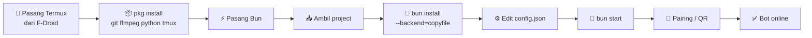

<!--
  ╔══════════════════════════════════════════════════════════════╗
  ║  CARA PAKAI TEMPLATE INI                                     ║
  ║  Cari teks "GANTI-" lalu ganti dengan URL milikmu:           ║
  ║    GANTI-URL-GIF-HEADER   → GIF banner utama (lebar ±800px)  ║
  ║    GANTI-URL-GIF-DEMO     → GIF demo bot saat jalan          ║
  ║    GANTI-URL-GIF-LOGIN    → GIF proses pairing/login         ║
  ║    GANTI-URL-GIF-FOOTER   → GIF penutup                      ║
  ║    GANTI-URL-VIDEO        → link video (YouTube / mp4)       ║
  ║    GANTI-URL-THUMBNAIL    → gambar thumbnail untuk video     ║
  ║    GANTI-URL-REPO         → link git repo project            ║
  ║  Catatan: GitHub tidak menjalankan CSS/JS di README, jadi    ║
  ║  animasi didapat dari GIF dan gambar SVG animasi di bawah.   ║
  ╚══════════════════════════════════════════════════════════════╝
-->

<div align="center">

<!-- ░░░ BANNER GELOMBANG ANIMASI ░░░ -->


<!-- ░░░ GIF UTAMA (GANTI URL) ░░░ -->


<!-- ░░░ TEKS KETIK ANIMASI ░░░ -->
<a href="https://github.com/DenverCoder1/readme-typing-svg">
  
</a>

<br/>

<!-- ░░░ BADGE ░░░ -->


<br/><br/>

**[✨ Fitur](#-fitur) · [🚀 Quick Start](#-quick-start) · [📱 Setup Termux](#-setup-lengkap-termux) · [🎬 Demo](#-demo) · [🛠️ Troubleshooting](#%EF%B8%8F-troubleshooting)**

</div>


## 🎬 Demo

<div align="center">

<!-- GIF demo bot (GANTI URL) -->


<br/><br/>

<!-- Thumbnail yang bisa diklik menuju video (GANTI URL) -->
<a href="GANTI-URL-VIDEO">
  
</a>

<sub>▶ Klik gambar untuk menonton video demo</sub>

</div>

> 💡 **Tips video langsung di README:** di GitHub, buka *Edit README* → seret file `.mp4` ke kotak editor.
> GitHub membuat link `user-attachments` otomatis, tempel saja di baris sendiri dan videonya langsung bisa diputar.

---

## ✨ Fitur

<table>
<tr>
<td width="50%" valign="top">

### 🧩 Sistem Command
- Muat command otomatis dari folder `commands/`
- **Auto-reload**: edit file, command langsung ter-update
- Kategori dari nama folder, alias, dan marker per-command/folder
- Syarat akses: owner, premium, admin, grup, private, register

</td>
<td width="50%" valign="top">

### 🎨 Tampilan Pesan
- Tombol interaktif, carousel, dan kartu katalog
- Thumbnail besar (location, product, link preview, image)
- Fake reply dengan banyak preset gaya
- Rich message ala AI (teks, sitasi, kartu)

</td>
</tr>
<tr>
<td width="50%" valign="top">

### 👑 Manajemen
- Owner utama + tambahan, tersimpan di `db/`
- Sistem user: level, EXP, koin, limit harian, premium
- Ban, warn, dan registrasi otomatis
- Tools saluran: ganti nama/deskripsi/foto, follow, kirim

</td>
<td width="50%" valign="top">

### 🔌 Koneksi Tangguh
- Login **pairing code** atau **QR**
- Session SQLite, sekali login langsung connect
- Reconnect otomatis dengan exponential backoff
- Cache metadata grup + LID mapping

</td>
</tr>
</table>

---

## 🚀 Quick Start

Sudah punya Bun dan project-nya? Cukup tiga baris:

```bash
bun install --backend=copyfile
nano config.json        # isi nomor owner & nama bot
bun start               # tambal zapo-js + jalankan bot
```

> Baru di Termux? Ikuti panduan lengkap di bawah. ⬇️

---

## 📱 Setup Lengkap (Termux)

<div align="center">
  <!-- GIF proses login (GANTI URL) -->
  
</div>

<br/>



<details open>
<summary><b>① Persiapan</b></summary>

<br/>

- Android dengan ruang kosong minimal ±1 GB
- **Termux dari [F-Droid](https://f-droid.org/packages/com.termux/)** atau GitHub Releases-nya (versi Play Store sudah usang)
- Nomor WhatsApp untuk bot (disarankan nomor terpisah dari nomor utama)
- Koneksi internet stabil

Izinkan akses penyimpanan (opsional, berguna untuk backup):

```bash
termux-setup-storage
```

</details>

<details open>
<summary><b>② Paket dasar Termux</b></summary>

<br/>

```bash
pkg update -y && pkg upgrade -y
pkg install -y git ffmpeg python tmux nano
```

| Paket | Kegunaan |
|:---:|---|
| `git` | mengambil dan memperbarui project |
| `ffmpeg` | konversi media (stiker, audio, video) |
| `python` | dibutuhkan tool unduhan (yt-dlp) |
| `tmux` | menjaga bot tetap jalan saat Termux ditutup |
| `nano` | editor untuk `config.json` |

</details>

<details open>
<summary><b>③ Pasang Bun</b></summary>

<br/>

```bash
pkg install -y bun
bun --version
```

Jika `pkg install bun` tidak ditemukan, cek dengan `pkg search bun`.
Pastikan `bun --version` menampilkan versi (project diuji di Bun 1.4.x, Android arm64).

</details>

<details open>
<summary><b>④ Ambil project</b></summary>

<br/>

**A. Lewat git**

```bash
cd ~
git clone GANTI-URL-REPO bocchigen2
cd bocchigen2
```

**B. Lewat file zip** (mis. `bot-zapo-bun.zip` di penyimpanan HP)

```bash
cd ~
pkg install -y unzip
unzip /sdcard/Download/bot-zapo-bun.zip -d bocchigen2
cd bocchigen2
```

Pastikan `index.ts`, `package.json`, dan `config.json` ada:

```bash
ls
```

</details>

<details open>
<summary><b>⑤ Pasang dependency</b></summary>

<br/>

> [!IMPORTANT]
> **Wajib pakai `--backend=copyfile` di Termux.**
> Android tidak mendukung hardlink/clonefile dengan baik, sehingga Bun memakai symlink ke
> `~/.bun/install/cache` dan modul jadi tidak saling menemukan. Gejalanya:
> `Cannot find module 'zapo-js/dist/util/index.js'` atau `typeModule is not a function` (jimp).

```bash
bun install --backend=copyfile
```

Proses bisa memakan beberapa menit. Setelah selesai, cek bahwa tidak ada symlink ke cache:

```bash
ls -la node_modules/@zapo-js
```

Isinya harus folder biasa, bukan panah `->` ke `~/.bun/install/cache/...`.

</details>

<details open>
<summary><b>⑥ Atur config.json</b></summary>

<br/>

```bash
nano config.json
```

| Kunci | Isi |
|---|---|
| `bot.name` · `bot.title` · `bot.footer` | nama dan tampilan bot |
| `owner.primary` | nomor owner utama, format `628xxxxxxxxxx` (tanpa `+`) |
| `owner.additional` | daftar nomor owner tambahan (opsional) |
| `prefix` | awalan command, mis. `["!", ".", "/", "#"]` |
| `pairing.usePairingCode` | `true` = pairing code, `false` = QR |
| `pairing.customCode` | kode pairing kustom, tepat **8 karakter** (kosongkan untuk acak) |
| `session.id` | nama sesi (biarkan `default` bila tidak perlu) |
| `group.id` · `channel.id` · `channel.link` | ID grup/saluran milikmu (opsional) |

Simpan: `Ctrl + O` → `Enter` → `Ctrl + X`.
`config.json` dibaca ulang otomatis saat berubah, tanpa restart.

</details>

<details open>
<summary><b>⑦ Jalankan & login WhatsApp</b></summary>

<br/>

```bash
bun start
```

`bun start` menambal `zapo-js` (agar pesan tipe *catalog* tampil) lalu menjalankan bot.
Pada run pertama, bot menanyakan metode login:

```text
Pilih metode login:
  [1] QR Code
  [2] Pairing
```

<table>
<tr>
<td width="50%" valign="top">

#### 🔑 Pairing *(disarankan, satu HP)*
1. Ketik `2`, lalu nomor WhatsApp bot (`628xxx`)
2. Bot menampilkan kode 8 karakter, mis. `F4R1-DEPP`
3. Di WhatsApp: **Perangkat tertaut → Tautkan perangkat → Tautkan dengan nomor telepon saja**, lalu masukkan kodenya

</td>
<td width="50%" valign="top">

#### 📷 QR Code *(butuh 2 HP)*
1. Ketik `1`, QR muncul di terminal
2. Perkecil font Termux (cubit layar) bila QR terpotong
3. Scan dari WhatsApp di HP lain: **Perangkat tertaut → Tautkan perangkat**

</td>
</tr>
</table>

Setelah tersambung, session tersimpan di `db/sqljs/session.db`. Jalan berikutnya langsung
connect tanpa login ulang, dan nomor yang tertaut otomatis terdaftar sebagai owner.

✅ Tes dengan mengirim `.ping` atau `.menu` ke bot. Hentikan bot dengan `Ctrl + C`.

</details>

<details open>
<summary><b>⑧ Biar bot tetap hidup 24/7</b></summary>

<br/>

Android bisa mematikan Termux di latar belakang. Lakukan ketiganya:

**1. Kunci CPU tetap menyala**

```bash
termux-wake-lock
```

**2. Jalankan di dalam tmux**

```bash
tmux new -s bot
cd ~/bocchigen2 && bun start
```

| Aksi | Perintah |
|---|---|
| Lepas tanpa mematikan bot | `Ctrl + B`, lalu `D` |
| Kembali ke bot | `tmux attach -t bot` |
| Hentikan sesi | `tmux kill-session -t bot` |

**3. Matikan optimasi baterai** untuk Termux di Pengaturan Android
(Baterai → Termux → Tidak dibatasi / Unrestricted).

</details>

---

## 🔄 Update, Backup, Reset

```bash
# ⬆️ Update
cd ~/bocchigen2 && git pull && bun install --backend=copyfile && bun start

# 💾 Backup (simpan di tempat aman)
tar -czf /sdcard/Download/bot-backup.tar.gz db config.json

# 🧹 Pasang ulang bersih
rm -rf node_modules bun.lock && bun install --backend=copyfile

# 🔁 Login ulang / ganti nomor
rm db/sqljs/session.db* && bun start
```

Setiap `zapo-js` terpasang ulang, patch dijalankan lagi lewat `bun start` (atau manual: `bun run patch`).

---

## 🛠️ Troubleshooting

| Gejala | Penyebab & solusi |
|---|---|
| `Cannot find module 'zapo-js/dist/util/index.js' from '.../.bun/install/cache/...'` | Paket terpasang sebagai symlink ke cache. Jalankan `rm -rf node_modules bun.lock`, `bun pm cache rm`, lalu `bun install --backend=copyfile`. |
| `TypeError: typeModule is not a function` (jimp) | Sama seperti di atas: `@jimp/*` tercampur versi 0.22. Pasang ulang dengan `--backend=copyfile`. Jangan menambal file di cache dengan `sed`. |
| `bun: command not found` | Bun belum terpasang. Ulangi langkah ③ lalu tutup-buka ulang Termux. |
| `pkg` error / gagal unduh | Pakai Termux dari F-Droid. Coba `termux-change-repo`, lalu `pkg update`. |
| `⚠ zapo-js BELUM ditambal` | Jalankan `bun run patch`, lalu restart bot. |
| Pola tambalan tidak cocok | Versi `zapo-js` berbeda dari yang diuji. Kirim output `bun run patch` ke developer. |
| Error soal `driver` SQLite | Cek: `grep -rn "driver" node_modules/@zapo-js/store-sqlite/dist --include=*.d.ts`, lalu sesuaikan `driver` di `connector/socket/socket.ts`. |
| Stiker/audio/video gagal | Pastikan ffmpeg terpasang: `pkg install ffmpeg`. |
| Bot sering terputus | Cek koneksi, aktifkan `termux-wake-lock`, dan jangan biarkan akun yang sama menggantikan sesi ("replaced"). |
| Logout dari HP | Hapus `db/sqljs/session.db*`, lalu login ulang (langkah ⑦). |

🔍 Log lebih detail: `DEBUG=1 bun start` atau `ZAPO_LOG_LEVEL=debug bun start`

---

## 🗂️ Struktur Project

```text
bot-zapo/
├── index.ts            ▶ titik masuk bot
├── config.json         ⚙ pengaturan statis (dibaca ulang otomatis)
├── commands/           🧩 command bot (auto-reload saat file berubah)
├── connector/          🔌 koneksi WhatsApp, logger, config
├── lib/                📚 user, owner, grup, serialisasi pesan
├── helpers/            🛠 pemuat command & penanganan pesan
├── src/                ✨ fitur tambahan (thumbnail besar, fake reply)
├── scripts/patch.ts    🩹 penambal zapo-js
└── db/                 💾 data runtime (session, user, marker, setting)
```

Semua path dihitung dari folder project, bukan dari folder tempat `bun` dijalankan.

---

## 🔐 Keamanan

> [!WARNING]
> - **Jangan bagikan** folder `db/` (session WhatsApp dan `db/certs/bot-private.pem`) maupun `config.json` (nomor owner).
> - Siapa pun yang memegang `session.db` bisa memakai akun bot.
> - Jika project masuk git, tambahkan ke `.gitignore`:
>   ```text
>   db/
>   config.json
>   ```

---

<div align="center">

<!-- GIF penutup (GANTI URL) -->


<br/>

<a href="https://github.com/DenverCoder1/readme-typing-svg">
  
</a>


</div>
